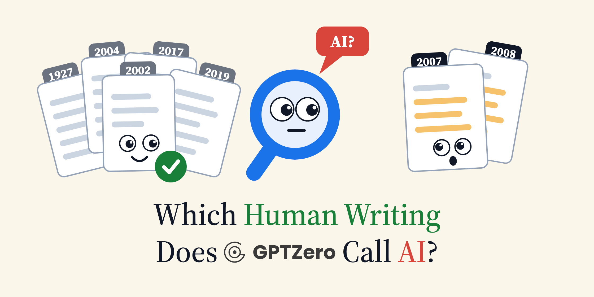
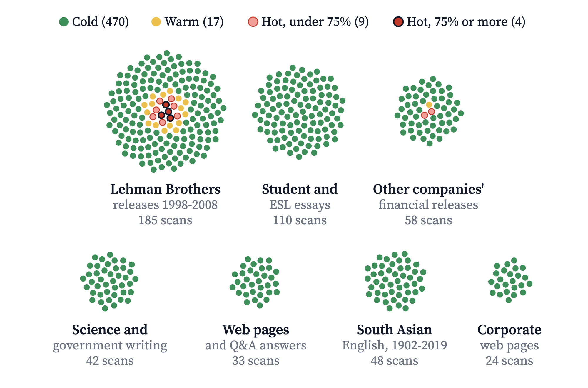
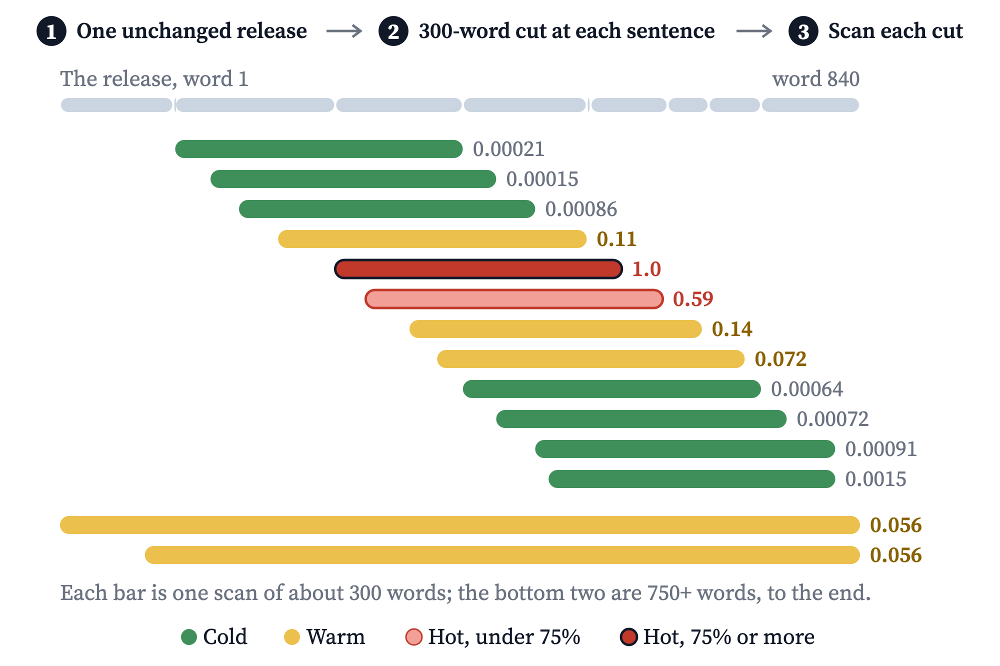

# Which Human Writing Does GPTZero Call AI?

[][post]
[][dataset]
[](LICENSE)
[](https://creativecommons.org/licenses/by/4.0/)



Code for my post [Which Human Writing Does GPTZero Call AI?][post]. I ran 500 scans of old human writing (1902-2020)
through GPTZero 5.0b, looking for text it calls AI. Almost all of it came back human. The exception was two unchanged
~300-word cuts of Lehman Brothers earnings releases, which scored 100% AI.

The scores are on [Hugging Face][dataset]. This repo recomputes the post from that dataset, and has the scripts I used
to collect the texts, scan them and compare detectors.

## What I found

| | Result |
| --- | --- |
| Human scans (253,098 words, 1902-2020) | 500 scans, 13 called AI, 4 at 75% AI or more |
| Lehman Q2 2007, 322-word cut | AI 100% (whole release: 0.025) |
| Lehman Q2 2008, 301-word cut | AI 100% (whole release: 0.056) |
| Liang et al.'s 91 TOEFL essays | 0 called AI (47 in 2023) |
| 105 more ESL essays from 2002 | 0 called AI |
| 118 AI texts from Qwen3-14B | 118 called AI |
| Pangram 4.1 on GPTZero's 20 warmest texts | all 20 human |



Each dot is one scan. The red ones are the texts GPTZero called AI, and nearly all of them are Lehman releases.



The same Q2 2008 release, cut at 14 different starting sentences. Only one cut scores 1.0, and both 750+ word cuts
come out human. This is why a 750-word false positive was out of reach.

## Quick start

All you need is Python 3.11+ and `huggingface_hub`. The scripts load the data from [Hugging Face][dataset] on the
first run and use the cached copy after that:

```
python3 recompute.py    # every number in the post
python3 tables.py       # Tables A1-A4
```

To use a local copy of the dataset's `data/` folder instead, set `GPTZERO_HUMAN_DATA` to it.

The figures need Pillow and the Source Serif 4 font (set `FIGURE_FONT` to the .ttf if it isn't found):

```
uv run --extra figures python -m figures.make_figures out/ --liang GPTZero.json
```

`GPTZero.json` is Liang et al.'s file with GPTZero's 2023 scores on their 91 TOEFL essays, from
[their repo](https://github.com/Weixin-Liang/ChatGPT-Detector-Bias) (`Data_and_Results/Human_Data/TOEFL_real_91`).
Pass it to `recompute.py` with `--liang GPTZero.json` for the two 2023 numbers.

Tests: `uv run pytest`. Tests that need a missing file are skipped.

## What's here

- `scan/` sends texts to the GPTZero API and saves each raw response. Needs `GPTZERO_API_KEY`, and it spends credits.
- `collect/` downloads the human texts (Wayback Machine, SEC EDGAR and a few other sites) and cuts them into whole
  sentences. `python3 -m collect.check` rebuilds texts from the download cache and checks them against the
  dataset's hashes.
- `controls/` has the 118 AI texts I had Qwen3-14B write to match human ones, and the comparison with other detectors
  (Binoculars, Fast-DetectGPT, RADAR, Desklib, Fakespot, OpenAI's RoBERTa, EditLens). Needs a GPU.
- `free_detectors/` scores the four Hugging Face detectors in Table A4.
- `figures/` draws the post's figures.

## Notes

- Not every text came from a script. I collected some of the early ones by hand: the NSF abstracts, the federal
  strategy documents, the Nepali newspapers, the Indian sources and the first Wayback corporate pages. For those, the
  source URL in the dataset is the record. Every scripted text I could check (335 of them) rebuilds exactly.
- A few picks were made by reading, not by a rule, such as which Bear Stearns releases to scan. The collectors list
  those explicitly.
- The other detectors' scores on the 118 pairs aren't in the dataset, so those numbers need a GPU rerun.
- The post's count of 628 windows includes withheld texts. From the released texts you get 384, and all 27 hot windows
  are among them.
- SEC EDGAR wants a name and an email in the User-Agent. Set `SEC_USER_AGENT`.

## Licence

The code is MIT. The dataset is CC BY 4.0, and the texts in it keep their sources' terms. Texts I couldn't release are
listed with their source, first and last words and a hash, so you can fetch them again with `collect/` and check them.

[post]: https://spanthi.com/blog/gptzero-human-writing/
[dataset]: https://huggingface.co/datasets/vein05/gptzero-human-writing

## Cite

```bibtex
@misc{panthi2026gptzero,
  author       = {Panthi, Sugam},
  title        = {Which Human Writing Does {GPTZero} Call {AI}?},
  year         = {2026},
  howpublished = {\url{https://spanthi.com/blog/gptzero-human-writing/}},
  note         = {Code: \url{https://github.com/Vein05/gptzero-human-writing}. Data: \url{https://huggingface.co/datasets/vein05/gptzero-human-writing}}
}
```
